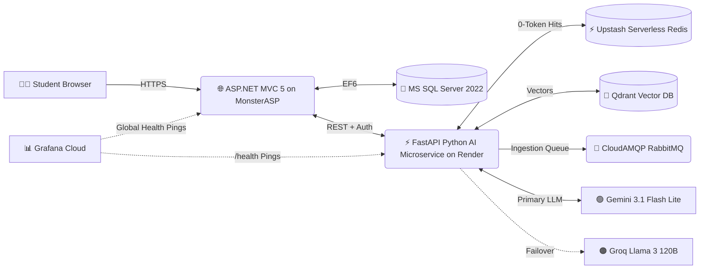

# 🎓 EduPlatform LMS — Enterprise AI-Powered Learning Management System

EduPlatform is a production-grade, enterprise-ready Learning Management System (LMS) built with **ASP.NET MVC 5 (.NET 4.8)**, **Microsoft SQL Server**, and a dedicated **FastAPI Python 3.11 Agentic RAG Assistant** powered by **Google Gemini 3.1 Flash Lite**, **Groq 120B failover**, **Upstash Cloud Redis**, **CloudAMQP RabbitMQ**, and **Grafana Cloud Observability**.

---

## 📖 Complete Documentation
For full architectural diagrams, component breakdowns, sequence flows, and environment settings, see:
👉 **[SYSTEM_ARCHITECTURE_GUIDE.md](./SYSTEM_ARCHITECTURE_GUIDE.md)**

---

## ⚡ Key Highlights & Architecture

### 1. Multi-Tier Production Infrastructure ($0/month Free Tiers)
- **Web App**: Hosted on MonsterASP.NET Windows Server 2022 IIS with automated Let's Encrypt Free SSL (HTTPS).
- **Database**: Cloud Microsoft SQL Server (35 relational tables, seed data, composite indexes, and stored procedures).
- **AI Microservice**: Containerized Python 3.11 / FastAPI running on Render with embedded Qdrant vectorstore.
- **Semantic Caching**: Upstash Serverless Cloud Redis caching responses with $\ge 95\%$ semantic similarity (<50ms latency, 0 tokens consumed).
- **Asynchronous Processing**: CloudAMQP Managed RabbitMQ with Dead-Letter Queues (DLQ) for multi-page document parsing.
- **Monitoring**: Grafana Cloud Synthetic Monitoring verifying global reachability, response latency, and SSL expiration 24/7.

### 2. Automatic Document Ingestion & RAG Retained Learning
When an instructor uploads a course PDF (`.pdf`), Word doc (`.docx`), PowerPoint (`.pptx`), or syllabus:
1. File bytes are transmitted to the AI microservice.
2. **PyMuPDF** extracts clean text, table data, and page numbers.
3. Chunks are converted into 3,072-dimensional embeddings via **Google Gemini `gemini-embedding-001`**.
4. Vectors are indexed into **Qdrant Vector Database** and **SQL Server Knowledge Chunks**.
5. Outdated semantic caches for that course in **Upstash Redis** are automatically invalidated.
6. The AI assistant immediately starts answering student inquiries directly citing the newly uploaded PDF and page numbers!

---

## 🚀 Quick Links
- **Live Platform**: [https://master-with-experts.runasp.net](https://master-with-experts.runasp.net)
- **AI Diagnostics**: [https://lms-ai-assistant.onrender.com/api/v1/health](https://lms-ai-assistant.onrender.com/api/v1/health)
- **Interactive Swagger Docs**: [https://lms-ai-assistant.onrender.com/docs](https://lms-ai-assistant.onrender.com/docs)
- **Grafana Metrics**: [https://wiseonion1173.grafana.net](https://wiseonion1173.grafana.net)
- **Architecture Blueprint**: [SYSTEM_ARCHITECTURE_GUIDE.md](./SYSTEM_ARCHITECTURE_GUIDE.md)
